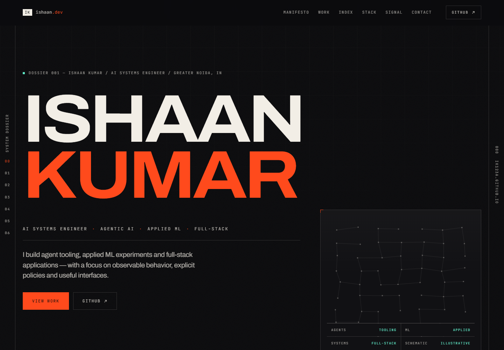
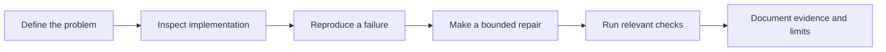

# Ishaan Kumar

**AI Systems Engineer | Agentic AI | Applied Machine Learning | Full-Stack Software Engineering**

I build agent tooling, applied ML experiments and full-stack applications. My focus is making behavior observable, testing failure cases, and explaining the boundary between an implemented prototype and a verified system.

[Portfolio](https://ik123a.github.io/) · [Public repositories](https://github.com/ik123a?tab=repositories) · [LinkedIn](https://linkedin.com/in/ishaan-kumar04/) · [Email](mailto:ishaanka111@gmail.com)

Actual browser capture of the portfolio revision proposed in [the site repair PR](https://github.com/ik123a/ik123a.github.io/pull/1). It is a preview of that revision; the deployed site may differ until the PR is merged.

## Engineering work

- **[AgentTest](https://github.com/ik123a/agenttest)** — Python tooling for testing AI agents. A [reviewable repair](https://github.com/ik123a/agenttest/pull/1) replaces truthiness-based judge decisions with validated verdict parsing and adds offline regression cases.
- **[VaultMind](https://github.com/ik123a/VaultMind)** — TypeScript agent-policy and tool-execution experiments. The [path-containment repair](https://github.com/ik123a/VaultMind/pull/1) covers sibling-prefix and link escapes and documents the process runner's limits. It does not provide OS-level isolation.
- **[Kairon](https://github.com/ik123a/Kairon)** — A Python semantic cache with precondition checks. The [cache-consistency repair](https://github.com/ik123a/Kairon/pull/1) covers replacement, stale aliases and bounded L1 promotion.
- **[Fusion](https://github.com/ik123a/fusion)** — A Next.js/tRPC workspace prototype. The [authorization repair](https://github.com/ik123a/fusion/pull/1) adds workspace access predicates and an explicit local fixture mode, with an actual demo screenshot and offline HTTP regressions.
- **[TruePlumb](https://github.com/ik123a/trueplumb)** — Finite-trace policy evaluation with an offline corpus and recorded adapter outcomes. Its tests check monitor behavior and log consistency; they do not rerun the vendor products represented in those logs.
- **[Cold-chain platform](https://github.com/ik123a/coldchain-platform)** — A deterministic educational fleet simulation with approval and recovery workflows. Synthetic backend tests, a frontend build and local sign-in captures support the [reviewable documentation update](https://github.com/ik123a/coldchain-platform/pull/3); no physical fleet was connected.

These links show implementation and review evidence. Open repair PRs are proposals until merged. Offline regressions establish the tested behavior; they do not establish live-provider reliability, production security or model accuracy. Each repository explains its setup and remaining verification gaps.

## How I approach projects

My projects span Python, TypeScript, Java and systems programming. I am interested in software and ML engineering opportunities where careful evaluation, useful interfaces and explicit operational limits matter.

For applied ML, see the [ResNet transfer-learning experiment](https://github.com/ik123a/resnet50-transfer-learning-cifar). Its [selection repair](https://github.com/ik123a/resnet50-transfer-learning-cifar/pull/1) separates validation-based configuration choice from held-out test reporting. Training and published accuracy were not reproduced in that repair.

Explore the [complete public repository list](https://github.com/ik123a?tab=repositories) for additional experiments and learning projects. The list stays current without a hardcoded repository count.
